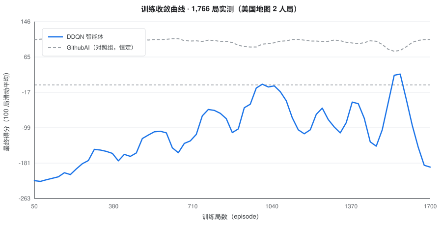

# DDQN on *Railroad Tour* (铁路环游)

**A from-scratch Double DQN implementation for a multi-player strategic board game — environment, baselines, training loop, and evaluation protocol all written in PyTorch.**

[]()
[]()
[]()

This repository is the reproducible codebase for my undergraduate thesis
*"深度强化学习在桌游《铁路环游》中的应用"* (Deep Reinforcement Learning Applied to the Board Game
*Railroad Tour*), Shanghai University of Finance and Statistics, 2025.

---

## 1. Problem

*Railroad Tour* is a multi-player strategic board game (2–5 players) played on a
graph of North American (or European) cities. Each round, players draw tickets,
buy railway routes, and compete for control of the network. A full game lasts
roughly 100–200 turns.

The learning problem is a **sequential decision problem with a large discrete
action space and severely delayed payoff**:

| Property | Value | Why it matters |
|---|---|---|
| Action space | 101 discrete actions (100 routes + 1 "wait") | Standard DQN fits exactly — no need for policy gradients |
| State space | 142 + 2×(number of players) ≈ 146 dims | Includes route control, ticket holdings, pile state, turn phase |
| Legal actions | state-dependent, often a small subset | Naive training wastes capacity on illegal moves |
| Reward | extremely sparse & delayed | Ticket payoff only materialises at game end |
| Terminal condition | non-stationary (end turn depends on play) | Needs careful handling of `done` |

### The three hard problems, and what I did about each

**① Sparse, delayed reward.** Ticket value is only realised when a ticket is
completed, which can be many turns later. I reward *route completion
immediately* but **defer the ticket bonus to the end of the episode**
(γ = 1). This forces the agent to plan for future route acquisition instead of
greedy short-term grabbing — the single most important design decision in the
project.

**② State-dependent legal actions.** The legal move set depends on the turn
phase (draw / buy / use / wait) *and* on card holdings. I implement an explicit
**action mask** derived from a finite state machine over the turn phase, and
apply it as a large negative penalty on Q-values before `argmax`:

```python
q_values = self.online_net(state)      # Q(s, ·) for all 101 actions
q_values -= 1e5 * (1 - mask)            # illegal actions pushed to -1e5
action = int(np.argmax(q_values))
```

**③ Unreliable loss as a convergence signal.** Because the mask zeroes the
loss contribution of illegal actions, states with fewer legal actions have
systematically smaller loss. Combined with stochastic replay sampling, the
recorded MSE became **wildly unstable — I observed values of 0.41 and ~1600
within the same training run** (≈4 orders of magnitude apart).

> **Consequence:** the loss curve cannot be used to decide when to stop
> training. I therefore use **win rate against a fixed baseline** as the
> convergence criterion, and cross-validate it (see §4).

---

## 2. Method

### 2.1 Environment & action mask

A finite state machine over the turn phase drives both the game logic and the
mask:

```
status = -1 (waiting) → 0 (draw ticket) → 1 / 1.5 (reveal or take shown card)
        → 2 (buy route) → 2.5 (choose colour) → 3 / 3.5 (use card)
```

The mask is recomputed from the current observation and the pending route
context, so the agent never selects an illegal action.

### 2.2 Network

```
state (≈146) ──▶ Linear(146→256) ─▶ ReLU ─▶ Linear(256→256) ─▶ ReLU ─▶ Linear(256→101) ─▶ Q(s,·)
```

### 2.3 Double DQN

Two networks (online / target), a replay buffer, and a decoupled target:

```python
current_q   = self.online_net(state).gather(1, action.unsqueeze(1))
next_action = torch.argmax(self.online_net(next_state), dim=1)   # ← online net picks
next_q      = self.target_net(next_state).gather(1, next_action.unsqueeze(1))
target_q    = reward + ((1 - done) * self.gamma).view(32, 1) * next_q
loss        = F.mse_loss(current_q, target_q.detach())
```

**Hyper-parameters** (locked after the runs reported here):

| | |
|---|---|
| Algorithm | Double DQN (off-policy value-based) |
| γ | 1.0 (full-horizon; terminal ticket bonus) |
| Optimiser | Adam, lr = 1e-3 (annealed as `1e-3 / (eps+1)^(1/3)`) |
| Replay buffer | 1000 transitions (`deque(maxlen=1000)`) |
| Batch size | 32 |
| ε (exploration) | 1.0 → 0.01, decay 0.998 per episode, 10-episode warm-up |
| Target network | synchronised from online net |
| Checkpoint | every 10 episodes (`torch.save`, ~2 MB each) |

### 2.4 Baselines (also written from scratch)

| Baseline | Description |
|---|---|
| **Heuristic AI** (`AIPlayer`) | Decision-tree policy: computes a *route value* per route (own route score + expected reduction in shortest-path distance weighted by ticket value) and a *ticket value* per ticket, then greedily maximises expected gain. Uses Dijkstra (`scipy.sparse.csgraph`) on a dynamically re-weighted distance matrix. |
| **GitHub open-source AI** (`GithubPlayer`) | Third-party baseline agent, used as an external reference point. |
| **Random AI** | Uniform over legal actions. |

---

## 3. Results

### 3.1 Head-to-head (US map, 2 players)

All numbers below are **reproduced from the raw episode logs in `data/`** by
`analysis/eval_episode_log.py` — they are not hand-transcribed.

| Match-up | Games | Win rate | μ (agent) | σ (agent) | **σ/μ** | t-stat | p-value | Pearson r |
|---|---|---|---|---|---|---|---|---|
| DDQN **vs** heuristic AI | 150 | **74.67 %** | 89.47 | 18.34 | **0.205** | 6.673 | 4.6e-10 | −0.243 |
| DDQN **vs** GitHub AI | 150 | **86.67 %** | 93.17 | 12.79 | **0.137** | 13.856 | 1.4e-28 | −0.239 |
| Heuristic AI **vs** GitHub AI | 50 | 48.00 % | 89.40 | 33.29 | **0.372** | −2.428 | 0.019 | −0.093 |
| DDQN @ 1 540 episodes **vs** GitHub AI | 150 | **44.67 %** | 48.54 | 24.71 | **0.509** | −3.074 | 0.0025 | −0.606 |

Reproduce any row with:

```bash
python analysis/eval_episode_log.py "data/Episode result_eval-2020-AI.txt"
```

### 3.2 Stability is not the same as win rate

The losing baseline makes the point that **variance across different opponents
is not comparable** (score scales differ), so I report the **coefficient of
variation σ/μ** instead:

| Agent | μ (score) | σ | **σ/μ** | Reading |
|---|---|---|---|---|
| DDQN | 89.47 | 18.34 | **0.205** | high & stable |
| Heuristic AI | 89.40 | 33.29 | **0.372** | same mean, 1.8× the relative spread |
| GitHub AI | 102.16 | 13.71 | **0.133** | low spread, mid ceiling |

The heuristic AI reaches essentially the *same mean* as the DDQN agent (89.40
vs 89.47) but with **1.8× the relative dispersion** — it wins big and loses
big. The DDQN agent is the opposite: it wins more often *and* loses less
badly.

### 3.3 How much training does it actually take?

Evaluating two checkpoints with an **identical protocol** (same opponent,
150 games per arm) isolates the effect of training volume:

| Checkpoint | Games trained | Win rate vs GitHub AI | σ/μ | Reading |
|---|---|---|---|---|
| `checkpoint_episode_1540` | 1 540 | **44.67 %** | 0.509 | barely above random — **not converged** |
| `checkpoint_episode_2020` | 2 020 | **86.67 %** | 0.137 | converged, high stability |

> A 480-episode difference produces a **42-percentage-point** win-rate gap.
> Training amount is not a detail — it is the difference between a
> non-functional and a strong agent.



*(100-episode moving average of the episode score, US map 2-player games. The
GitHub-side reference stays flat at ≈ +105 throughout, which is what makes the
rising DDQN trend interpretable rather than an artefact of opponent drift.)*

### 3.4 Honest scope of the claims

- All numbers above are **US map, 2-player** games, as stated in the thesis.
  This is a deliberate restriction, not a limitation of the implementation.
- The agent learns a **counter-strategy against a specific opponent**; it does
  not generalise to unseen opponents (see the 45 % row in §3.1). In RL the
  opponent *is* part of the environment, so changing the opponent changes the
  environment.
- The evaluation set is 150 games per arm. That is enough to separate the
  74.7 % / 86.7 % results from chance (p < 0.001) but **not** enough to
  resolve differences of a few percentage points.

---

## 4. Evaluation protocol

Because the loss function is unreliable (§1③), the evaluation protocol is
designed to make the *convergence claim* falsifiable:

1. **Fixed protocol** — identical opponent, map, player count, and number of
   games (150/arm) for every checkpoint compared.
2. **Two metrics, always reported together** — win rate (central tendency) and
   σ/μ (stability). Neither alone is sufficient.
3. **Statistical test** — Welch's t-test on the score samples.
4. **Checkpoint sweep at a fixed protocol** — not just "the final checkpoint",
   but a controlled comparison of two checkpoints (§3.3).
5. **A controlled reference arm** — the GitHub-side agent's episode score is
   plotted as a flat reference line, so that drift in the opponent or in the
   environment cannot masquerade as learning progress.

---

## 5. Repository layout

```
ddqn-multiplayer-boardgame/
├── README.md
├── LICENSE                       MIT
├── requirements.txt
├── train.py                      CLI: training loop (argparse)
├── evaluate.py                   CLI: evaluate a checkpoint against a baseline
├── make_convergence_svg.py       regenerates docs/convergence.svg from results/
├── ddqn/
│   ├── __init__.py
│   ├── config.py                 all hyper-parameters in one place
│   ├── env.py                    Game, Player, Card, Ticket, Route, Dijkstra helpers
│   ├── network.py                FNN (the Q-network)
│   ├── ddqn_agent.py             DDQNPlayer: mask, action selection, training step
│   └── baselines.py              AIPlayer (heuristic), GithubPlayer
├── analysis/
│   └── eval_episode_log.py      win rate, σ/μ, t-test, Pearson r from a raw log
├── data/                         raw episode logs (1,766 training games + evaluations)
├── results/
│   ├── matchups.csv              head-to-head summary (win rate, μ, σ, σ/μ, p, r)
│   ├── checkpoints.csv           checkpoint sweep at a fixed protocol
│   ├── segments.csv              per-100-game segment statistics
│   └── train_ma.csv              moving-average series used for the curve
└── docs/
    └── convergence.svg           training curve
```

## 6. Reproducing

```bash
pip install -r requirements.txt

# Train (default: 2050 episodes, US map, 2 players)
python train.py --episodes 2050 --learn

# Evaluate a specific checkpoint against the heuristic AI
python evaluate.py --checkpoint checkpoints/ddqn_checkpoint_episode_2020.pth \
                   --opponent heuristic --games 150

# Evaluate against the GitHub baseline
python evaluate.py --checkpoint checkpoints/ddqn_checkpoint_episode_2020.pth \
                   --opponent github --games 150
```

All game data (cities, routes, tickets, decks) is embedded in
`ddqn/env.py` — **there is nothing to download**.

## 7. Requirements

Python ≥ 3.9, `torch` ≥ 2.0, `numpy`, `scipy`.

## 8. License

MIT — see [LICENSE](LICENSE).

## 9. Citation

If this code is useful for your work, please cite the underlying thesis:

> 赵光琪. *深度强化学习在桌游《铁路环游中的应用*. 本科毕业论文, 上海财经大学统计学, 2025.
